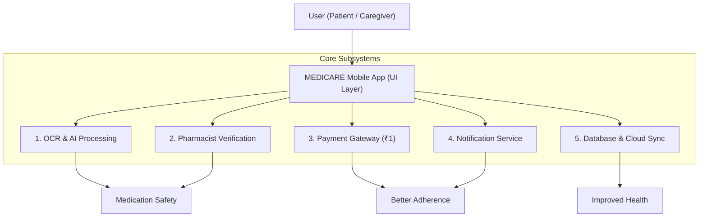

# MEDICARE: Smart Medicine. Safe Life.
> **An AI-Powered Smart Medication Management and Patient Safety Mobile Application**  
> *Course: Doctor of Pharmacy (Pharm.D) | Department of Pharmacy Practice*

---

## 📱 Project Overview

**MEDICARE** is an AI-assisted medication management, adherence, and patient safety application designed to address critical medication-safety challenges:
1. **Prescription Transcription & Comprehension:** OCR and AI text extraction with high-visibility confidence and uncertainty flagging.
2. **Clinical Pharmacist Verification:** Professional review routing with a nominal **₹1 Translation Lock & Verification** gateway.
3. **Multilingual Access:** Native regional language instructions across **English, తెలుగు (Telugu), हिन्दी (Hindi), தமிழ் (Tamil), and ಕನ್ನಡ (Kannada)**.
4. **Smart Dose Reminders:** Configurable time and day schedules with interactive **Snooze (10 min)** and **Stop / Taken** controls.
5. **Expiry Monitoring:** Automated detection of packaging dates, generating proactive alerts (30, 15, and 7 days before expiry).
6. **Suspicious Medicine Detection:** Verification against authentic CDSCO/WHO datasets and cautious warnings for unverified packaging.
7. **Offline-First Resilience:** Encrypted local database supporting full offline reminder scheduling and dose logging.
8. **Unused Medicine Donation:** Authorized collection centre locator and strict clinical eligibility checklist for unused medicines.

---

## 🖼️ The 14 Application Screens (Matching System Poster)

| # | Screen Name | Description & Key Safety Features |
|---|---|---|
| **1** | **Splash Screen** | MEDICARE Blue Heart + Medical Cross branding, *"Smart Medicine. Safe Life."*, *"Get Started"* button. |
| **2** | **Registration / Create Account** | Full Name, Mobile Number, Email Address, Create Password, Register & Login modes. |
| **3** | **Language Selection** | Native language selector for **English, Telugu, Hindi, Tamil, and Kannada** with checkmark indicator. |
| **4** | **Home Dashboard** | *"Hello, User! 👋"*, Notification Bell, *"Take your medicines on time!"* clock banner, 6-card quick action grid (Scan Prescription, Scan Medicine, Reminders, Expiry Alerts, My Records, Donate Medicines), and 4-tab bottom navigation. |
| **5** | **Prescription Scan** | Camera viewfinder with Rx watermark, paper prescription sample selector, scanning laser animation, and instant OCR field extraction. |
| **6** | **Medicine Scan** | Packaging & barcode viewfinder with green *"✓ Details Extracted"* card (Medicine Name, Mfg Date, Exp Date, Batch No, and Confirm CTA). |
| **7** | **Pharmacist Verification (₹1)** | Shield icon, *"Verification Required - Some information needs pharmacist verification"*, *"Unlock Translation & Verification for ₹1 only"*, interactive UPI/Card payment modal, and *"or Continue Later"*. |
| **8** | **Verified Details** | Green *"Verified by Pharmacist"* badge, verified medicine info (dose, frequency, duration), and *"Translation Unlocked"* card in selected regional language with text-to-speech audio. |
| **9** | **Dose Reminder** | Bell icon, *"Set Reminder"*, stepper time selector (08:00 AM +/-), day of week pills, *"Enable Reminder"* toggle, and interactive Snooze & Stop alarm modal. |
| **10** | **Expiry Alert** | Warning triangle icon, high-visibility red banner (*"This medicine is expiring in 7 days!"*), batch and shelf-life details, and safe disposal advice. |
| **11** | **Suspicious Medicine Alert** | Red warning icon, *"Suspicious Medicine Detected! Please verify with a pharmacist"*, blister strip visual, and *"Contact Pharmacist"* helpline action. |
| **12** | **Medication Records ("My Records")** | Segmented tabs (`All` \| `Active` \| `Completed`), active medicine list (Paracetamol, Amoxicillin, Vitamin D3), and adherence status. |
| **13** | **Donate Medicines** | Heart-in-hands icon, *"Donate Unused Medicines"*, CDSCO/FDA donation eligibility checklist, and authorized collection centre submission. |
| **14** | **Feedback** | *"Your Feedback Matters!"*, interactive 5-star rating system, suggestion notes, and persistent store logging. |
| **15** | **Profile & Disclaimer** | User profile, active language switch, and mandatory **Medical Disclaimer** (Report §6.16). |
| **16** | **System Architecture View** | Interactive flowchart of the Poster Architecture (User -> UI Layer -> 5 Subsystems -> Clinical Outcomes) + one-click toggle to the **Pharmacist Verification Portal**. |

---

## 🏛️ System Architecture



---

## 🚀 Running the Application

### 1. Patient App & Interactive Showcase (Port 5173)
```bash
cd patient-app
npm run dev
```
Open **`http://localhost:5173`** in your browser.

- Use the **Top Screen Switcher** dropdown to instantly jump to any of the 14 poster screens for demonstrations and grading.
- Use the **Language Dropdown** to test real-time switching between English, Telugu, Hindi, Tamil, and Kannada.
- Switch to the **Pharmacist Portal** tab to inspect the registered pharmacist verification queue and cryptographic audit logs.

### 2. Trust Layer Backend (Port 4000)
```bash
cd backend
npm run dev
```
Runs the Express REST API with Ed25519 bundle signing and verification endpoints.

### 3. Run Automated Tests
```bash
npm test
```
Executes all 25 unit and integration tests across crypto bundles, expiry date evaluation, translation lock gates, and MEDICARE features.
